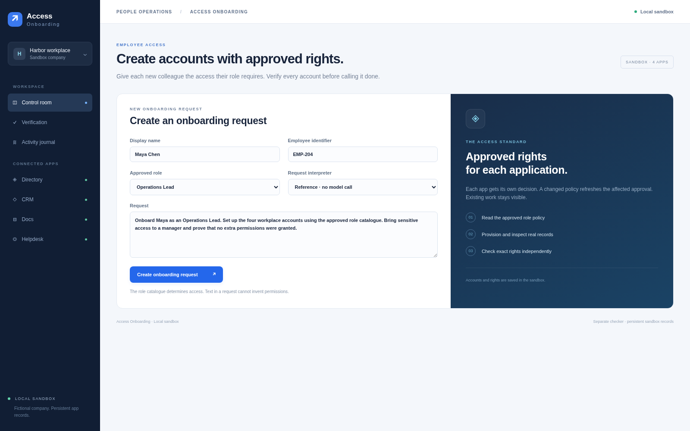
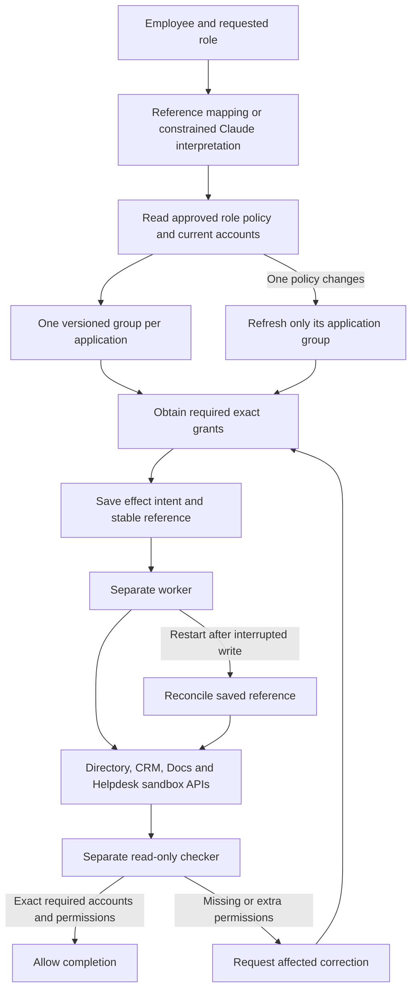

# Access Onboarding


A workplace operator that provisions a new colleague's exact approved role access across four persistent sandbox applications: Directory, CRM, Docs, and Helpdesk. Sensitive groups require a manager's grant. Policy changes refresh only affected groups. A separate checker refuses completion until every required account has the right permissions and no additions.

[Demo video](https://drive.google.com/file/d/147FlCRrvrBMWWdlKeJVysy1kzfbYsRTd/view) · [Validation](docs/VALIDATION.md)



The cover is illustrative; the workspace is an actual screenshot. The 1:53 demo is an edited reference-planner capture of fictional apps, with synthetic Kokoro af_heart narration. A separate live Claude role-interpretation smoke check succeeded.

## Run

Python 3.11 or newer, with no third-party packages:

```sh
python run.py --port 8892
```

Open `http://127.0.0.1:8892`. All application data is fictional sandbox data saved in local SQLite stores. No external workplace account is created.

```sh
python -m unittest discover -s tests -v
```

## Live demonstration

1. Create the default Operations Lead request. The selected mode is visible. Reference mode makes no model call.
2. Approve CRM and Docs separately. Change CRM role policy while those grants are waiting. CRM asks again; Docs retains its grant.
3. Approve the revised CRM card. Choose **Crash after the next account write**. The worker exits abruptly after an actual application write, before recording that write as complete in its journal.
4. Resume the worker. It looks up the saved effect reference and records its existing result. The Directory app contains one account and one write event.
5. Check the source records and complete onboarding. Introduce unexpected CRM access, then check again: completion must be refused. Review the change, approve only the CRM correction, and resume.

Use **New request** to start another colleague's onboarding. The saved-request
selector lets you inspect earlier requests without resetting their records.

## What is autonomous

The worker discovers current app policy and existing accounts, validates grants before writes, provisions permitted work, leaves other decisions pending, recovers interrupted writes by reference lookup, and updates individual groups when policy or source records change. Role policies and supported app actions are engineered and inspectable. This prototype handles one defined type of work across three approved roles.

Reference mode maps a structured role directly to policy. It is a deterministic baseline, not an AI-performance result. Optional **Live Claude Code** uses an installed, authenticated Claude Code CLI to interpret the request and provide a rationale. The requested role remains constrained by the approved catalogue; model output cannot invent rights or approve its own actions. The live interpreter is intentionally small. Existing authentication stays in the CLI and is not copied into the app.

## Architecture and invariants



`business.db` stores application accounts, role policies, idempotent references, and write events. `runtime.db` stores requests, groups, grants, effect intent, and the activity journal. A worker runs in a separate process. The checker runs in another process, reads the runtime with SQLite `mode=ro`, reads current business records over HTTP, and writes only `checker.db`.

Each grant binds exact account effects, policy version, and a ten-minute expiry. The application write endpoint also checks these conditions. A changed policy invalidates only its matching group. Each account is unique by employee and application, and each effect reference is unique. The checker requires one account per required app, exact rights, the requested role, active status, and no unexpected app accounts. Completion rechecks the authoritative record hash before changing the request status.

This is the development profile: processes share one local OS account. Code and process separation do not provide OS isolation. The local manager controls and deliberate fault injection are demonstration tools, not a production authentication system. Production integration, SSO, tenant authorization, private app credentials, and OS/container isolation remain future work. The prototype uses local APIs, not browser automation or real SaaS connectors.

## Tests

**10 tests pass**, covering real process interruption, concurrent repeated writes, exact permissions, stale grants, approval bypass refusal, source drift and checker write separation. [Validation](docs/VALIDATION.md) records the scope and source hashes. These are sandbox correctness tests, not a measured real-world success rate.

## Assumptions and next steps

The employee identity and approved role catalogue are supplied. Each sandbox
application exposes account reads and transactional writes with a stable effect
reference. A manager shown in the interface is a simulated role, not an
authenticated enterprise identity. The worker provisions access; it does not
infer a company's security policy from an employee's message.

Next steps are a real test-tenant connector, authenticated approvers, secret
storage, offboarding with reversible revocations, and independent worker/checker
identities. Integration tests should establish how each external application
handles duplicate requests and delayed reads before enabling writes there.
